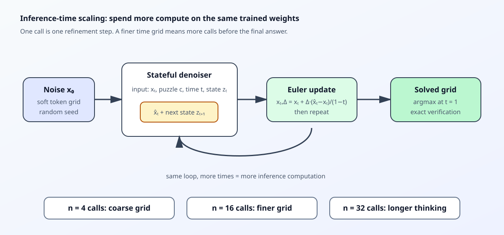

# Thinking with Looped Flows: CPU Demo

This repository is a small, offline experiment inspired by [Thinking with Looped Flows](https://arxiv.org/abs/2609.11801). It is intentionally **not** a reproduction of the paper's ARC or Sudoku benchmark numbers. The goal is to make one idea observable and testable on a free CPU:

> Keep the model weights fixed, spend more computation during inference, and measure whether the answer improves.

## What is inference-time scaling?

Inference-time scaling means increasing the amount of computation used **after training** for one input. With an autoregressive model such as Qwen, this might mean generating more reasoning tokens, sampling multiple candidates, or running a verifier. In this project, it means integrating the same learned probability flow with a finer temporal grid:

```text
4 flow steps  ->  4 denoiser calls
16 flow steps -> 16 denoiser calls
32 flow steps -> 32 denoiser calls
```

The model is not made larger and the training set is not changed. The extra compute is a controlled inference budget. It is different from generating a longer text answer: the loop refines a soft categorical grid internally and returns a fixed-size Sudoku solution.



## The experiment

The core task is unique 4x4 Sudoku completion:

1. Generate a valid solved grid and hide cells while retaining a unique solution.
2. Represent the target grid as one-hot categorical vectors.
3. Mix the target with Gaussian noise at a time `t`:

   ```text
   I_t = (1 - t) x_0 + t x_1
   ```

4. Train a stateful denoiser to predict `x_1` from `I_t`, the clues, `t`, and a recurrent state.
5. Train local losses at ordered times while detaching the recurrent state between times. This avoids full backpropagation through the whole flow trajectory.
6. At inference, start from noise and apply Euler updates:

   ```text
   x_(t+dt) = x_t + dt * (D_t(x_t) - x_t) / (1 - t)
   ```

7. Evaluate the same trained model at several step counts.

The `no-state-flow` ablation trains the same type of denoiser without carrying the recurrent state. It asks whether the scaling curve depends on learned recurrence rather than repeated calls alone.

## Repository structure

```text
src/looped_flows_cpu/
  data.py       # deterministic unique-Sudoku generator and encodings
  model.py      # small NumPy denoiser and Adam optimizer
  flow.py       # local-loss training and probability-flow integration
  metrics.py    # CSV/JSON result writers
  experiment.py  # end-to-end CLI and plot generation
scripts/
  run_experiment.py  # documented entry point
  qwen_baseline.py   # optional local-only Qwen comparison
tests/             # data, model, flow, and metrics tests
docs/
  inference_time_scaling.svg
results/
  metrics.csv       # measured accuracy/latency/call counts
  metadata.json     # seed, versions, sizes, and configuration
  summary.md        # human-readable result table
  accuracy_vs_steps.png
```

The implementation uses NumPy rather than a large deep-learning framework so the core experiment is transparent, quick to inspect, and runnable on a CPU with no cloud service. The manual gradients are deliberate: an intern can see exactly where the local loss updates the shared denoiser.

## Run locally, offline

Python 3.10+ and NumPy are sufficient for the experiment. Pytest and Matplotlib are used for tests and the plot.

```bash
python3 -m pip install -e '.[dev]'
PYTHONPATH=src pytest
PYTHONPATH=src python scripts/run_experiment.py
```

The default run generates only synthetic local data and writes small result files under `results/`. For a quick smoke run:

```bash
PYTHONPATH=src python scripts/run_experiment.py \
  --train-size 160 \
  --validation-size 32 \
  --test-size 64 \
  --train-steps 40 \
  --batch-size 32 \
  --eval-steps 2,4,8
```

The output table reports exact puzzle accuracy, total model calls, elapsed time, and mean time per call. Latency is hardware-dependent; accuracy and model-call count are the primary reproducibility signals.

## Optional Qwen baseline

Qwen is not a drop-in implementation of Looped Flows. A normal Qwen checkpoint is an autoregressive next-token model, while this demo trains a categorical denoiser that consumes soft noisy grids and carries a recurrent hidden state. The optional adapter exists only to compare a local open model on the same puzzle format:

```bash
python3 -m pip install -e '.[qwen]'
export HF_HUB_OFFLINE=1
export TRANSFORMERS_OFFLINE=1
PYTHONPATH=src python scripts/qwen_baseline.py \
  --model-path /absolute/path/to/already-downloaded-qwen \
  --prompt 'Solve this 4x4 Sudoku and output only the 16 digits: ...'
```

The adapter requires a model directory that is already present. It never downloads weights and is not needed for the core result.

## How to read the result

The key comparison is the `looped-flow` accuracy row as `flow_steps` increases:

| Observation | Meaning |
| --- | --- |
| Accuracy rises with steps | The model benefits from spending more inference compute. |
| Accuracy is flat | The task/model is already solved at the coarse grid, or the recurrence did not learn useful refinement. |
| Accuracy falls at high steps | Numerical error, over-refinement, or an unstable learned vector field. |
| Looped flow beats no-state flow | The recurrent state carries useful intermediate computation. |

The experiment does not prove that more compute always helps. It measures the claim on a small controlled task and includes the ablation needed to avoid attributing all gains to recurrence.

## Senior-engineer walkthrough

**Why generate data locally?** A tiny deterministic task removes download, licensing, and cloud-cost variables. It lets us debug the algorithm before using a language model or a large benchmark.

**Why train a denoiser instead of wrapping Qwen?** The paper's object is a stateful denoiser over a continuous path between noise and a categorical answer. Qwen's standard interface emits one discrete token after another. Replacing Qwen's input/output geometry is a new research project, not a safe inference wrapper.

**Why share the same noise across local training times?** It associates the ordered denoising objectives with one problem and one trajectory. The state sees a sequence whose noise level decreases, so it can learn to carry useful work forward. The paper also discusses the resulting shortcut risk; this demo keeps the comparison small and explicit.

**Why detach the state?** Full backpropagation through all inference steps defeats the point of the local objective and makes memory grow with the trajectory. Detaching means each local loss teaches the shared denoiser how to use the state value it receives, without requiring backpropagation through every earlier update.

**Why report model calls and latency?** Accuracy alone hides the cost of the scaling strategy. `n=32` is only a win if its quality improvement is worth 8x the model calls compared with `n=4`.

**What would we do next?** Add stochastic integration and best-of-many trajectories, then test an independent Qwen baseline. Only after the CPU reproduction is stable would it be worth implementing a Qwen-sized soft-token denoiser or moving to a standard tensor framework.

## Limitations

- This is a small NumPy teaching implementation, not the paper's 5–7M-parameter TRM-style architecture.
- The 4x4 Sudoku distribution is synthetic and much smaller than the paper's benchmarks.
- Wall-clock numbers depend on the local CPU and BLAS implementation.
- The optional Qwen adapter is a separate autoregressive baseline; it does not claim architectural parity.
